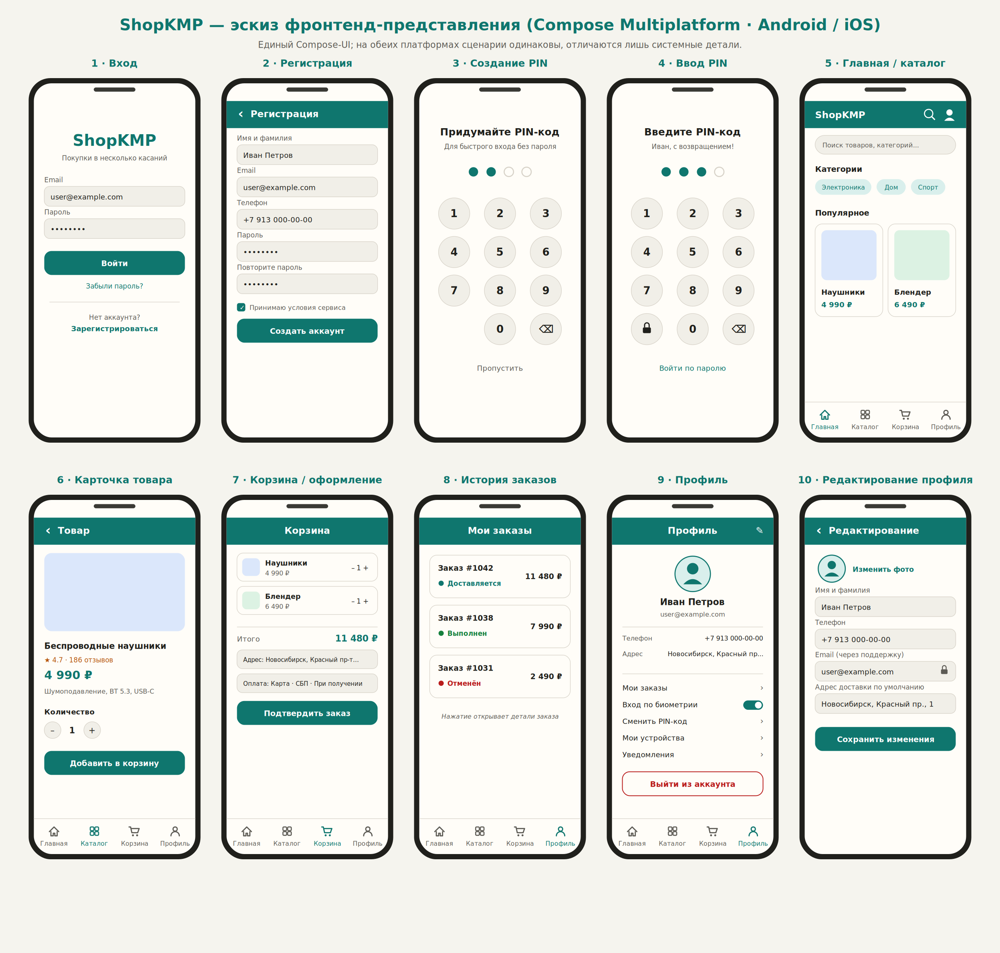

# ShopKMP — Yii2 business API, Go SDUI, Compose Multiplatform

A persistent Android/iOS shop with Keycloak authentication, catalog/search,
cart, checkout, payments, orders, profile and device credentials. The root
runtime uses **PHP 8.3 / Yii2 for business logic** and an **independent Go 1.26
HTTP-only SDUI BFF**. The shared commonMain client renders eight destinations
with the existing UIKit and keeps authentication/security/checkout native.

```text
Android / iOS → one Nginx edge
                  ├─ /api/v1/screens/*, /api/v1/sdui/* → Go BFF
                  │                                      ↓ internal HTTP
                  └─ business API, media, callbacks → yii2-http:8080 → Yii FPM:9000
                                                                       ├─ PostgreSQL
                                                                       ├─ Keycloak → separate PostgreSQL
                                                                       ├─ OpenSearch
                                                                       └─ configured payment provider
```

Only the edge publishes a host port. The BFF has no database or identity-provider
credentials. The canonical business contracts live in `backend-yii2/contracts/`;
the independent `tools/ops` module provides the checksum-validating one-shot
migrator and Keycloak HTTP probe. The retired Go business source and original
archive have been removed after extracting these essentials; see
[decommissioning and preserved artifacts](docs/LEGACY_REMOVAL.md).

## UI design



## Run locally

Requires Docker Compose **2.24.4+**, Docker Engine and Python 3.9+. Go 1.26 is
needed for host-side verification; Docker builds both services independently.
On Linux OpenSearch requires `vm.max_map_count=262144`.

```sh
cp .env.example .env
make run
```

`make run` builds/starts the stack, waits for real probes, then explicitly runs
the development seed and search reconciliation. The seed creates two sample
products only when **both catalog tables are empty**; it never overwrites a
populated catalog and is forbidden in production. `make up` starts without seeding.

* API and SDUI: **http://127.0.0.1:8080**
* Development Swagger: **http://127.0.0.1:8080/swagger/**; serves the unchanged
  [canonical OpenAPI](backend-yii2/contracts/openapi.yaml).
* No direct database, Keycloak, search, FPM or BFF host ports.

```sh
curl --fail http://127.0.0.1:8080/api/v1/screens/home
make logs
make down                    # retains persisted volumes
```

Set `EDGE_PORT` in `.env` for another port. The isolated integration stack runs at
**http://127.0.0.1:58095** under project **`shopkmp-migrated-e2e`**.

## Verification

```sh
make compose-config
make integration-up          # isolated project; loopback 58095
make integration-check       # writes only disposable test data
make check                   # Docker PHP unit/lint, BFF + ops tests/races/vet, Compose config
make test-php                # standalone Docker build/tests; no .env or host PHP needed
# Against an already-running disposable stack:
SHOPKMP_E2E_URL=http://127.0.0.1:58095 make e2e
```

`integration-check` checks the frozen 54-operation route manifest, scheduler
regressions, seed preservation and initial reindex, the CARD demo-payment journey,
all eight schema-validated BFF screens/six commands, live BFF races/vet, ops
tests/vet and the complete PHP business/API/concurrency/security suite through the
shared edge. A test-only provider fixture is used; normal security limits remain
enabled. Runtime probes check private services, history and graceful restart.

The prior Go/Yii comparison is retained as **historical evidence**: 54 operations,
194 paired HTTP cases, 189 matches and five documented compatibility corrections.
Its comparison harness and reference writers have been retired. Recorded PHP
counts and mobile/Kover results in the reports describe those earlier runs, not
new decommissioning passes. [Exact historical parity scope](docs/API_PARITY_REPORT.md) ·
[Historical verification](docs/VERIFICATION_REPORT.md) ·
[Handoff and current checks](docs/COMPLETION_REPORT.md).

Installed Android/iOS journeys exercise the same edge, including UI signup/PIN,
SDUI, native checkout, Chrome/Safari CARD demo capture, paid orders and logout.
[Mobile evidence and rerun commands](docs/MOBILE_E2E_REPORT.md).

CI checks both Go modules, standalone Docker PHP unit/lint, contracts, runtime
image builds and root full-stack integration. Android/iOS jobs remain in place;
the KMP **70%** coverage gate is unchanged. `make coverage` reports BFF coverage
only, without replacing the retired Go business/financial coverage metric.

Real production-provider settlement, physical biometric hardware and production
restore/cutover remain separate release gates. No production cutover has occurred.

## Deployment and mobile endpoints

[DEPLOYMENT.md](docs/DEPLOYMENT.md) covers local/production TLS, private services,
secrets, issuer/JWKS, database histories, scheduled jobs, backup/rollback and
single-writer staged rollout. Start from `.env.prod.example`, provision the
required real secrets/certificates, then use `make prod-config` / `make prod-up`.
Production publishes only HTTPS on one domain; Swagger/operational routes are hidden.

Android emulator custom-port build:

```sh
SHOPKMP_DEBUG_SERVER_URL=http://10.0.2.2:58095 ./gradlew :composeApp:assembleDebug
```

iOS simulator uses `BACKEND_SERVER_URL=http://127.0.0.1:58095` in the Xcode build
settings. Exact build/install commands and physical-device routing are in the
deployment guide. Normal client defaults remain port 8080. Platform builds and
91 real simulator cases passed in Task3. Later native-security/startup regressions
and installed CARD journeys have their own evidence in the mobile report.

```sh
# Running disposable stack at58095 and the indicated booted devices are required.
python3 scripts/run_android_installed_journey.py --serial emulator-5554
python3 scripts/run_ios_installed_journey.py --udid <booted-iPhone-simulator-UDID>
```

## Contracts and design

| Artifact | Purpose |
| --- | --- |
| [Architecture](docs/ARCHITECTURE.md) | Current runtime and trust boundaries |
| [Canonical OpenAPI](backend-yii2/contracts/openapi.yaml) / [frozen routes](backend-yii2/contracts/routes.json) | 54 business operations; original names/access policies and decimal-string money |
| [Route matrix](docs/ROUTE_MATRIX.md) | Exact methods/policies, PHP coverage, 8 screens + 6 commands |
| [SDUI v1 contract](docs/SDUI_CONTRACT.md) | Finite wire types, schemas, 13 shared fixtures, native actions |
| [Decommissioning](docs/LEGACY_REMOVAL.md) / [ops tools](tools/ops/README.md) | Preserved SQL/checksums, realm, migrator/probe and external-release rollback |
| [Migration strategy](docs/MIGRATION_PLAN.md) | Historical compatibility invariants and cutover planning |
| [Implementation plan](docs/IMPLEMENTATION_PLAN.md) | Historical Task4 checkboxes and execution ledger |
| [Yii2 service](backend-yii2/README.md) / [BFF service](backend-sdui/README.md) | Build/configuration and focused test suites |
| [CMP report](docs/CMP_IMPLEMENTATION_REPORT.md) | Shared renderer, native integration and platform evidence |

Client stack: Kotlin 2.3.10, CMP 1.10.3, Ktor 3.5, Koin 4.2, Navigation3,
SQLDelight and existing UIKit. Infrastructure: PostgreSQL 17, Keycloak 26.3.3,
OpenSearch 2.19.3 and Nginx. Historical screenshots/draw.io and migration reports
describe earlier stacks; the root Compose files define the current runtime.
Actual rollback uses an independently retained immutable release and verified
business/identity database backups, as described in the deployment guide.
