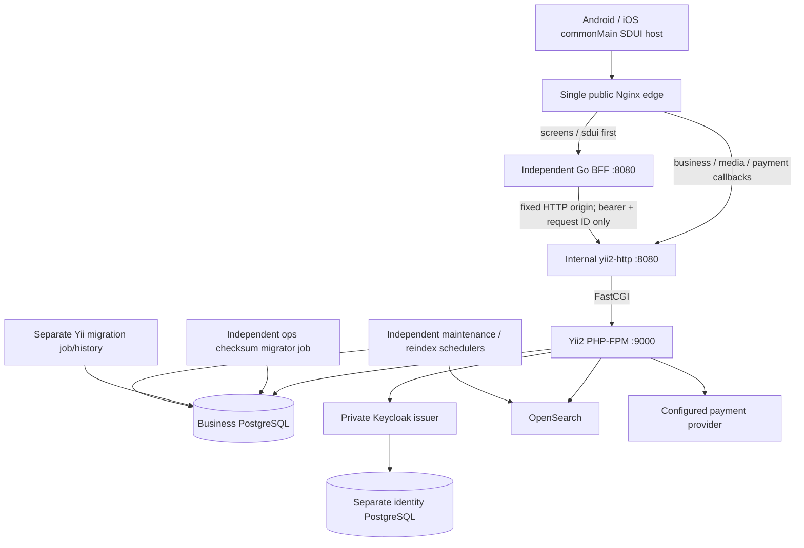

# Current ShopKMP architecture

The root Compose files are the current runtime authority. Historical draw.io,
screenshots and migration reports describe the retired Go business stack. The
current repository contains Yii2, its HTTP-only BFF and independent ops tools;
the original business source/archive have been decommissioned.

## Ownership and interfaces

* **Yii2** owns all 54 canonical business operations, SQL transactions, auth,
  profiles/media, catalog/search, cart/orders, payment/webhook and review rules.
  Thin controllers dispatch application services/repositories. No PHP request
  proxies business work to Go.
* **BFF** composes eight typed documents using real canonical HTTP DTOs and six
  finite reauthenticated commands. It neither reads SQL nor receives DB/Keycloak
  credentials. Its application port is 8080; its separate internal operational
  port is 9090. No personalized shared cache or fixture fallback exists.
* **CMP** has four shared `core/sdui-*` modules and `feature/main` host. The
  singleton existing RequestExecutor owns transport/token refresh. UIKit callback
  state is local. Account-scoped drafts/intents are cleared on sign-out/account
  change. Password/PIN/biometric, payment origin policy and critical checkout
  semantics stay native; no arbitrary remote URL/method/code execution.
* **Contracts** live in `backend-yii2/contracts/openapi.yaml` (unchanged canonical
  OpenAPI) and `routes.json` (frozen 54-operation names/methods/access policies).
* **Ops** is the independent Go 1.26 module `shopkmp/ops` in `tools/ops`, with
  pinned pgx v5.10.0 used only by the infrastructure migrator. It preserves all
  22 SQL up/down files for migrations 001–011 byte-for-byte and validates the
  existing `schema_migrations` history. `deploy/migrate.Dockerfile` builds only
  `cmd/migrate`. `deploy/keycloak/Dockerfile` adds the standard-library
  `cmd/healthcheck` probe to official Keycloak 26.3.3; the unchanged realm lives
  in `deploy/keycloak/shopkmp-realm.json`. Both Docker build contexts are
  `tools/ops`. No Go process serves database-backed business requests.
* **Verification** uses the same Yii/BFF edge plus a disposable provider fixture;
  its overlay adds only fixture support and Yii's verification-network access.
  Prior differential/reference-writer comparisons survive as historical evidence,
  not current runtime dependencies. See [decommissioning](LEGACY_REMOVAL.md).

See the [exact route matrix](ROUTE_MATRIX.md) and [SDUI contract](SDUI_CONTRACT.md).
Money is an exact decimal string at both HTTP boundaries and integer kopecks for
business arithmetic. PostgreSQL NUMERIC and existing replay/hash formats remain.

## Routing and network boundaries

1. `/api/v1/screens/*` and `/api/v1/sdui/*` take priority and reach BFF.
2. Other `/api/v1/*`, `/uploads/*`, `/images/products/*`, `/icons/*` and
   `/demo/payments/*` reach internal Yii HTTP, then FPM. PHP disables demo payment
   in production; configuring a real provider also disables it in development.
3. Swagger serves the unchanged canonical static OpenAPI only in development.
   Development additionally exposes health/live/ready for integration probes.
   Production has no public health, metrics, Swagger or FPM operational paths.

Only edge has `ports`. The `ingress` network has three fixed addresses (edge,
Yii HTTP and BFF); `application` carries internal HTTP/provider access; `data`
is internal and carries the two private databases. PHP/Keycloak have database
network access; BFF and edge have neither data-network membership nor DB secrets.
Docker DNS is re-resolved by Nginx so recreated upstream containers do not leave
stale addresses. No additional service port is implicitly published.

## Client identity and proxy trust

The edge reconstructs a finite header allowlist and generates correlation IDs.
Client `Forwarded`, `X-Forwarded-For`, `X-Real-IP`, proxy-host, cookies and
user/role/admin-identity headers are not copied upstream. It sets **one**
`X-Real-IP` from its socket peer. The internal Nginx real-IP module accepts it
**only from the fixed edge IP**, then passes the resolved address as FastCGI
`REMOTE_ADDR`. PHP has `TRUSTED_PROXY_CIDRS=""` and never reparses an untrusted
forwarding chain. The same resolved address drives auth/network budgets and
webhook CIDR checks. HMAC/webhook headers and the explicit admin-bootstrap
credential are preserved; neither is a trusted identity header.

BFF intentionally forwards only bearer/request ID and finite command headers.
Its Yii calls therefore use the BFF's internal socket address for network budgets;
per-user budgets still derive from the freshly verified actor. External business
auth/webhooks go directly through edge → Yii and retain the actual socket client.
On Docker Desktop the host appears as the ingress gateway (`172.30.95.1` in the
executed test), not as loopback. Internet deployments must put this edge directly
on the ingress; adding a CDN/load balancer needs an explicitly tested trusted-hop
configuration rather than accepting client forwarding headers.

## Identity and TLS

Password authentication runs through PHP; Keycloak is not exposed to CMP or the
browser. The preserved realm/client/service account is mounted unchanged. Issuer
is `http://keycloak:8080/realms/shopkmp` in development and
`https://keycloak:8443/realms/shopkmp` in production. Keycloak advertises that same
origin for discovery/JWKS; PHP verifies issuer/signature/audience/azp/typ and
requires same-origin JWKS discovery. No internal/public issuer rewrite is used.

Production edge uses TLS 1.2/1.3 and one domain. Both DBs require TLS; libpq uses
verify-full plus PGSSLROOTCERT, including Yii's separate migration connection.
Keycloak's JDBC uses verify-full. PHP curl/OpenSSL trust the provisioned combined
CA bundle for Keycloak, OpenSearch and the real HTTPS payment provider. Search
uses authenticated TLS and custom node certificates; fresh bootstrap contains
only the explicitly configured admin user, no demo credentials/certificates.
Keycloak 26.3.3's private management probe also verifies its HTTPS certificate.
Internal edge/BFF/Yii HTTP hops are private Compose HTTP by design.

## Lifecycle and transaction invariants

PostgreSQL healthy → ops checksum migration → separate Yii migration;
OpenSearch healthy + Yii migration → initial reindex → FPM/Keycloak healthy →
Yii HTTP ready → BFF/edge. Migration containers exit successfully; they are not
business servers. Existing schema history/data are retained; there is no new
baseline or reset. Application startup never seeds. `make run` explicitly invokes
the development-only seed command after startup; the transaction locks both
catalog tables and does nothing if either is populated.

Independent PHP scheduler processes run `maintenance/run` every 60 seconds and
`maintenance/reindex` every 300 seconds; a long reindex cannot block reservation
maintenance. Each avoids overlapping its own job, reports failures and has a
heartbeat healthcheck. Initial reindex is a separate required one-shot job.

Checkout retains key-scoped advisory/cart/product locks, exact current-price
calculation and atomic order/items/payment/stock/cart/replay writes. PHP owns
webhook HMAC/source/time/dedup and state transitions. BFF mutations and native
payment confirmation are single-attempt; ambiguous results reconcile through
trusted reads and explicit same-intent recovery, not blind mutation retries.

Edge/internal Nginx have bounded bodies and header/body/upstream timeouts; BFF
has whole-operation deadlines and wire limits; FPM terminates overlong requests.
SIGQUIT drains Nginx/FPM, SIGTERM drains BFF and stops scheduler children; Compose
grace periods exceed configured request/drain budgets. Actual probes/stop codes,
contracts and remaining production/device gaps are recorded in
[VERIFICATION_REPORT.md](VERIFICATION_REPORT.md).
